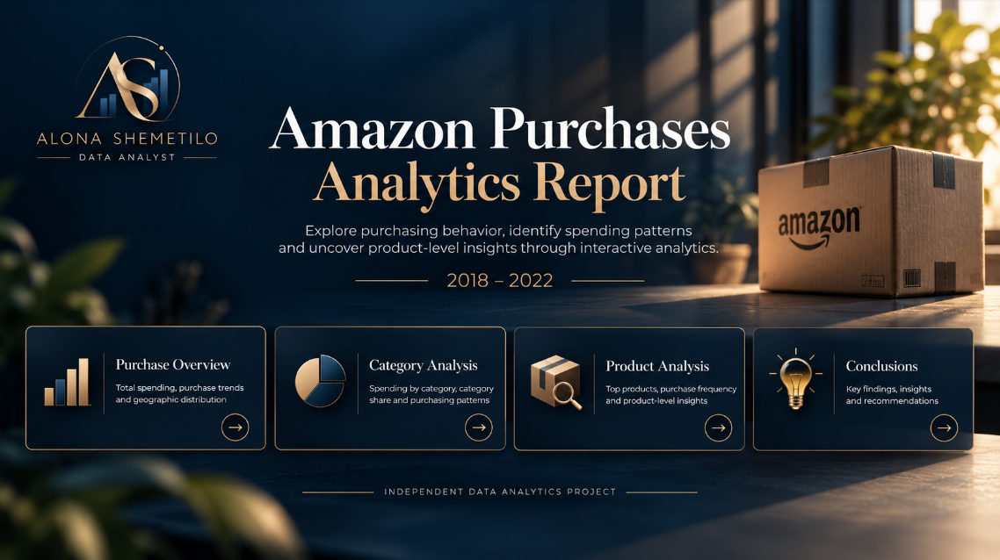
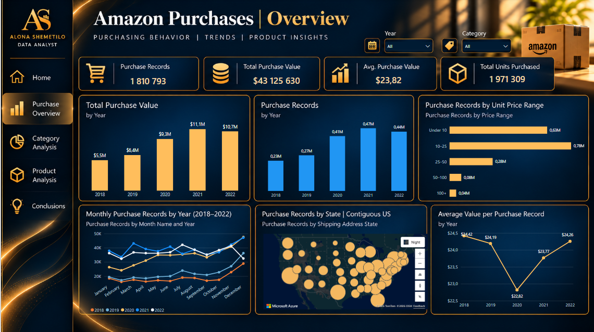
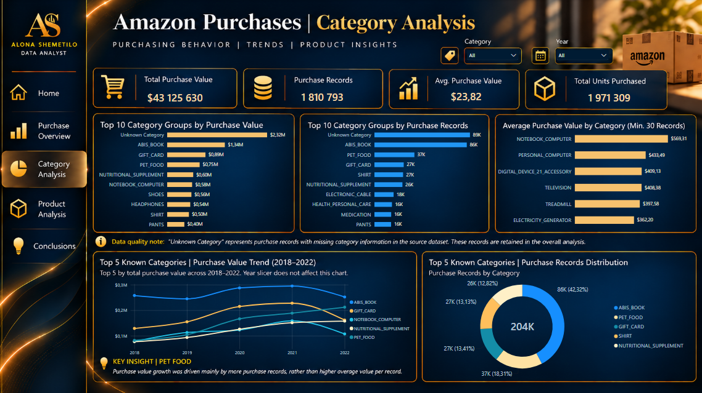
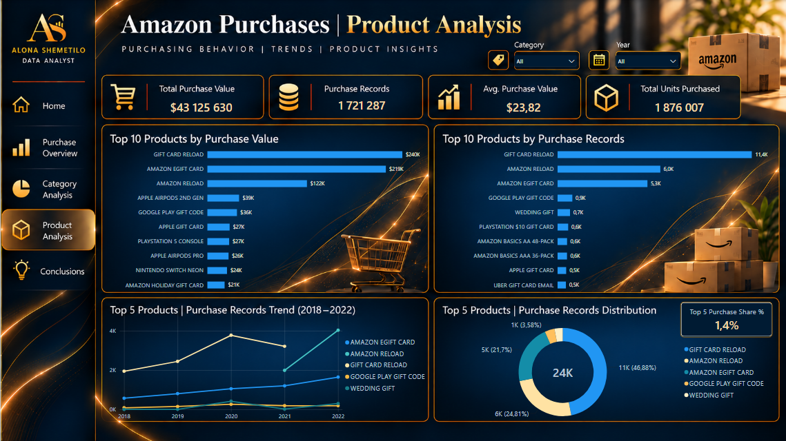
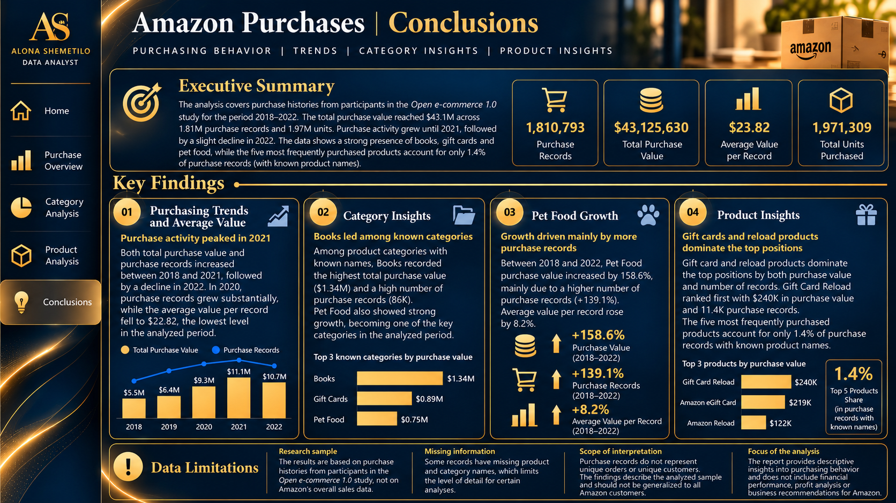

# Amazon Purchases Analytics | Power BI

**Samodzielny projekt portfolio z zakresu Data Analytics i Business Intelligence**  
**Autorka:** Alona Shemetilo  
**Narzędzia:** Power BI Desktop · Power Query · DAX · Modelowanie danych

> **Status:** projekt opublikowany. Interaktywny raport Power BI, plik PBIX oraz dokumentacja techniczna są dostępne publicznie.

**[Otwórz interaktywny raport Power BI](https://app.powerbi.com/view?r=eyJrIjoiMzE0NTVlY2YtOGE2OC00N2UyLTg5NTQtM2QyNmJlMDA4ZTJiIiwidCI6IjNkZmU5YWI2LTgxYmYtNDkxYy1iNjcwLTAxYzgyNGEwOWUxOSJ9)** · **[Pobierz PBIX](https://github.com/alona-shemetilo/amazon-purchases-powerbi-analytics/releases/download/v1.0/Alona_Shemetilo_Amazon_Purchases_Analytics.pbix)** · **[Dokumentacja techniczna](https://github.com/alona-shemetilo/amazon-purchases-powerbi-analytics/blob/main/documentation/Dokumentacja_techniczna.pdf)**

## O projekcie

**Amazon Purchases Analytics** to interaktywny raport Power BI analizujący historie zakupów na Amazon.com udostępnione przez uczestników badania *Open e-commerce 1.0* w USA. Analiza obejmuje lata **2018–2022** i **1 810 793 rekordy zakupowe**.

Celem projektu było przekształcenie dużego zbioru danych w czytelny raport pozwalający analizować zmiany aktywności zakupowej w czasie, porównywać kategorie i produkty oraz samodzielnie eksplorować wyniki.

**Zakres interpretacji:** są to dane uczestników badania, a nie pełna ani reprezentatywna baza sprzedaży Amazon. Raport nie przedstawia oficjalnych przychodów firmy.

## Pytania analityczne

- Jak zmieniały się wartość zakupów, liczba rekordów i średnia wartość rekordu w latach 2018–2022?
- Jak wyglądały miesięczne trendy, rozkład cen jednostkowych i liczba rekordów według stanów dostawy?
- Które kategorie wyróżniały się pod względem wartości i liczby rekordów?
- Jak zmieniały się wyniki wybranych kategorii, w szczególności `PET_FOOD`?
- Które produkty najczęściej występowały w danych i jaki udział stanowiło TOP 5 produktów o znanych nazwach?

## Główne KPI

| KPI | Wynik (2018–2022) |
| --- | ---: |
| Purchase Records | **1 810 793** |
| Total Purchase Value | **43 125 630 USD** |
| Average Value per Purchase Record | **23,82 USD** |
| Total Units Purchased | **1 971 309** |

**Purchase Records** oznacza liczbę wierszy danych źródłowych — nie liczbę unikalnych zamówień ani klientów. **Total Units Purchased** sumuje zakupione sztuki, dlatego różni się od liczby rekordów. **Total Purchase Value** wynika z cen jednostkowych i ilości w badanym zbiorze.

## Wybrane wyniki analizy

- **Trendy zakupowe:** wartość zakupów wzrosła z około **5,5 mln USD w 2018 r.** do **11,1 mln USD w 2021 r.**, a w **2022 r.** obniżyła się do około **10,7 mln USD**. Liczba rekordów również osiągnęła maksimum w 2021 r.
- **Średnia wartość rekordu:** w 2020 r. spadła do **22,82 USD**, mimo wyraźnego wzrostu liczby rekordów. Pokazuje to, dlaczego warto analizować liczbę i wartość zakupów oddzielnie.
- **Kategorie:** wśród kategorii o rozpoznanych nazwach najwyższą wartość zakupów odnotowała `ABIS_BOOK` (około **1,34 mln USD**), następnie `GIFT_CARD` (około **0,89 mln USD**) i `PET_FOOD` (około **0,75 mln USD**).
- **PET_FOOD:** między 2018 a 2022 r. wartość zakupów wzrosła o **158,6%**, liczba rekordów o **139,1%**, a średnia wartość rekordu o **8,2%**. Wzrost wartości wiązał się przede wszystkim z większą liczbą rekordów.
- **Produkty:** wśród produktów o znanych nazwach wysokie pozycje zajęły `GIFT CARD RELOAD`, `AMAZON EGIFT CARD` i `AMAZON RELOAD`. Pięć najczęściej występujących produktów stanowiło około **1,4% rekordów z rozpoznanymi nazwami produktów** — nie 1,4% wartości zakupów.

Wyniki opisują analizowany zbiór; nie stanowią podstawy do wnioskowania o zachowaniach wszystkich klientów Amazon ani do ustalania przyczyn zmian.

## Decyzje projektowe i uzasadnienie

W projekcie istotne było nie tylko przygotowanie wizualizacji, ale również świadome określenie jednostki analizy, zasad czyszczenia danych i kontekstu obliczeń.

| Decyzja | Dlaczego zastosowałam takie rozwiązanie? |
| --- | --- |
| **Zachowanie rekordów z brakującymi nazwami** | Nie usuwałam automatycznie rekordów bez nazwy produktu lub kategorii, aby nie zaniżać ogólnych KPI. Braki oznaczyłam jako `Unknown Product` i `Unknown Category`; w rankingach wymagających identyfikacji produktu pomijam `Unknown Product`. |
| **Oddzielenie rekordów od sztuk i zamówień** | Jeden rekord może obejmować więcej niż jedną sztukę, a rekord nie musi odpowiadać unikalnemu zamówieniu. Dlatego `Purchase Records` i `Total Units Purchased` są osobnymi wskaźnikami. |
| **Dobór KPI do dostępnych danych** | Wybrałam miary opisujące skalę, wartość i dynamikę zakupów. Nie obliczałam marży, zysku ani ROI, ponieważ zbiór nie zawiera danych pozwalających wiarygodnie je wyznaczyć. |
| **Tabela kalendarza `DimDate`** | Oddzielna tabela dat porządkuje analizę roczną i miesięczną oraz wspiera miary porównujące okresy, w tym Year-over-Year. |
| **Rozdzielenie analizy ogólnej i produktowej** | W rankingach produktów wykluczam nierozpoznane nazwy, aby brak danych nie był prezentowany jako konkretny produkt. W rezultacie niektóre wskaźniki na stronie `Product Analysis` mają węższą podstawę niż KPI ogólne. |
| **Stały zakres historyczny wybranych wykresów** | Niektóre trendy i porównania TOP 5 obejmują cały okres 2018–2022 niezależnie od części segmentatorów. Dzięki temu zachowują wspólny punkt odniesienia. |
| **Oddzielna strona `Conclusions`** | Podsumowanie przygotowałam jako statyczną infografikę dla pełnego okresu analizy, aby najważniejsze wnioski nie zmieniały kontekstu pod wpływem filtrów. |
| **Kontrola jakości i walidacja** | Weryfikowałam m.in. braki, pełne duplikaty, wartości `Quantity`, podstawowe KPI, relacje, interakcje i wydajność wybranych wizualizacji, aby ograniczyć ryzyko błędnej interpretacji. |

**Ważna uwaga o stronie `Product Analysis`:** liczba rekordów (**1 721 287**) i liczba sztuk (**1 876 007**) odnoszą się do węższego zakresu bez części rekordów o nierozpoznanych nazwach. Jednocześnie karty wartości zakupów i średniej wartości rekordu pozostają zgodne z ogólnymi KPI. Oznacza to, że **nie wszystkie karty na tej stronie mają identyczny kontekst filtrowania** — należy uwzględnić to podczas porównywania wyników.

## Realizacja techniczna

**Power Query:** import `amazon-purchases.csv`, kontrola typów danych i brakujących wartości oraz zapytania kontrolne `Check_Quantity_Fractions` i `Check_Full_Duplicates`.

**Model danych:** tabela faktów `amazon-purchases` i tabela kalendarza `DimDate`, połączone relacją **1:*:**

`DimDate[Date] (1) → amazon-purchases[Order Date] (*)`

Dodatkowo: `Check_Rows_By_Year` do kontroli danych oraz `Measures Table` do organizacji miar. Kalendarz obejmuje lata 2018–2024, ale dane zakupowe analizowane w raporcie dotyczą wyłącznie lat 2018–2022.

**DAX:** osiem miar, w tym KPI, porównania rok do roku i udział TOP 5, oraz pięć kolumn obliczeniowych wspierających m.in. przedziały cenowe, sortowanie, etykiety produktów i prezentację geograficzną.

**Walidacja:** kontrole danych, wyników DAX, filtrów, nawigacji i wybranych wizualizacji z użyciem Performance Analyzer. Szczegółowe formuły, testy i ograniczenia opisano w dokumentacji technicznej.

## Struktura raportu

| Strona | Zakres |
| --- | --- |
| `LP` | Wprowadzenie i nawigacja |
| `Purchase Overview` | Główne KPI, trendy roczne i miesięczne, przedziały cenowe, stany dostawy |
| `Category Analysis` | Rankingi, struktura i zmiany kategorii |
| `Product Analysis` | Rankingi i trendy produktów, udział TOP 5 |
| `Conclusions` | Stałe podsumowanie wyników i ograniczeń |
| `Data Validation` *(ukryta)* | Pomocnicza kontrola danych i obliczeń |

## Podgląd raportu

### Landing Page

### Purchase Overview

### Category Analysis

### Product Analysis

### Conclusions

## Materiały projektu

- **[Interaktywny raport Power BI](https://app.powerbi.com/view?r=eyJrIjoiMzE0NTVlY2YtOGE2OC00N2UyLTg5NTQtM2QyNmJlMDA4ZTJiIiwidCI6IjNkZmU5YWI2LTgxYmYtNDkxYy1iNjcwLTAxYzgyNGEwOWUxOSJ9)**
- **[Plik Power BI (.pbix)](https://github.com/alona-shemetilo/amazon-purchases-powerbi-analytics/releases/download/v1.0/Alona_Shemetilo_Amazon_Purchases_Analytics.pbix)**
- **[Dokumentacja techniczna (PDF)](https://github.com/alona-shemetilo/amazon-purchases-powerbi-analytics/blob/main/documentation/Dokumentacja_techniczna.pdf)**

## Źródło danych i ograniczenia

**Źródło:** Berke, A., Calacci, D., Mahari, R., Yabe, T., Larson, K., & Pentland, S. (2023). *Open e-commerce 1.0: Five years of crowdsourced U.S. Amazon purchase histories with user demographics*. Harvard Dataverse, V1.  
**DOI:** [10.7910/DVN/YGLYDY](https://doi.org/10.7910/DVN/YGLYDY)  
**Licencja wskazana w dokumentacji zbioru:** CC0 1.0.

Najważniejsze ograniczenia:

- Dane pochodzą od uczestników badania i nie są reprezentatywne dla wszystkich klientów Amazon.
- Rekord zakupowy nie jest równoznaczny z unikalnym zamówieniem, klientem ani transakcją rozliczeniową.
- Brakujące nazwy produktów i kategorii ograniczają szczegółowość analiz; `Unknown Category` nie jest rzeczywistą kategorią biznesową.
- Stan na mapie oznacza **stan adresu dostawy**, a nie potwierdzone miejsce zamieszkania uczestnika.
- Niektóre wizualizacje stosują stały zakres czasu lub odmienny kontekst filtrów.
- Analiza jest opisowa i eksploracyjna: nie ustala przyczyn, nie prognozuje sprzedaży ani nie ocenia rentowności Amazon.

## Autorka

**Alona Shemetilo**  
Portfolio: **Data Analytics / Business Intelligence**  
Rozwijane umiejętności: **Power BI · SQL · Excel**

*Projekt wykonany samodzielnie jako element portfolio analitycznego. Nie jest realizacją na zlecenie Amazon.*
